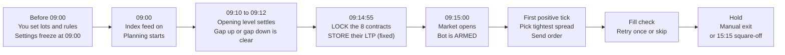
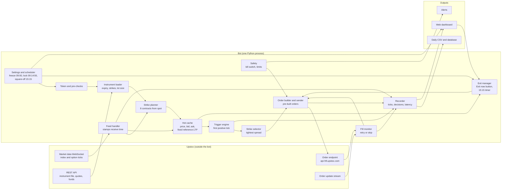
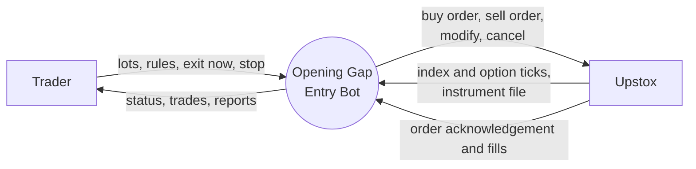
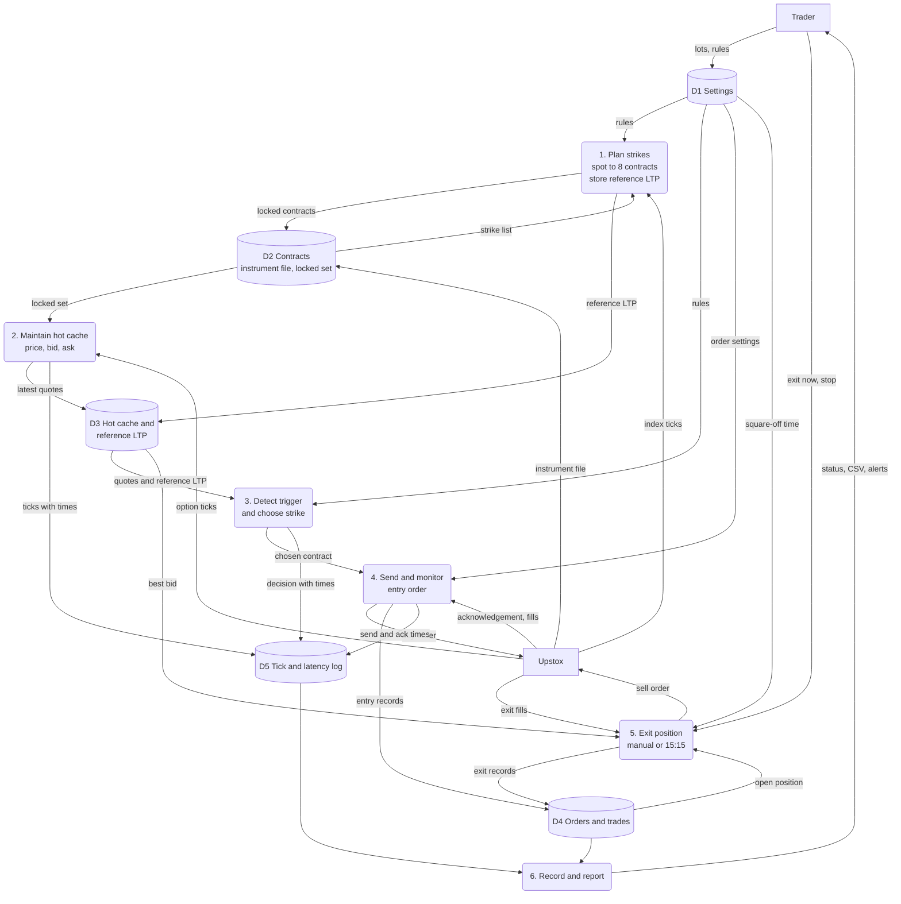
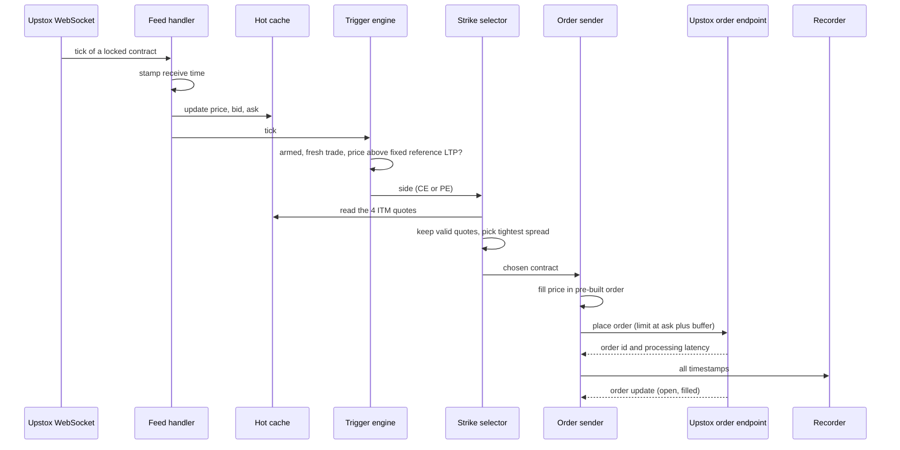
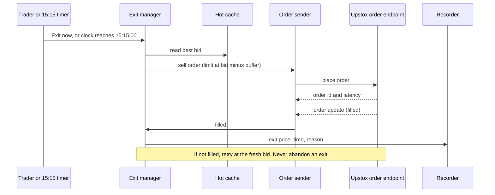
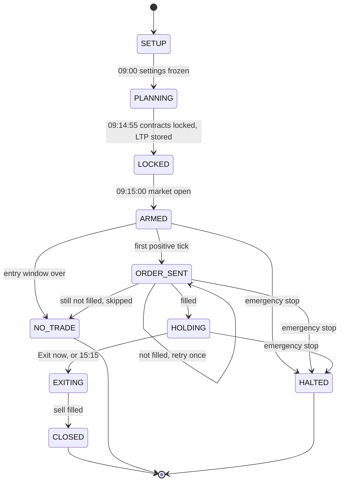

# Opening Gap Entry Bot (NIFTY): Rules, Architecture and Data Flow

Version 2.1. This replaces the earlier Qty/Value buy-pressure strategy.
Updated 3 November 2026 with the client's first answers. Scope: NIFTY 50 options, paper trading first.

---

## 1. The idea in one paragraph

Before the market opens, the bot watches the NIFTY index during the pre-open session (09:00 to 09:15) to see whether the market will open gap up or gap down. At about 09:14:55 it locks the **8 option contracts** nearest to that opening level (the **4 in-the-money calls and the 4 in-the-money puts**) and **stores the LTP of each one. That stored LTP is fixed for the day.** At 09:15:00 it watches those 8 contracts. The **first positive tick**, meaning a fresh trade above the stored LTP, decides the side (CE or PE). The bot then picks the **ITM strike with the tightest spread on that side** and sends a buy order immediately, with the number of lots you set before the market opened. After the entry the exit is **manual, or automatic at 15:15**.

---

## 2. Decisions confirmed by the client

| # | Topic | Decision |
|---|---|---|
| 1 | Reference price for a "positive tick" | The LTP of each contract **stored during pre-market (at lock time) and fixed**. Not the previous day close. |
| 2 | Best strike | The **tightest spread**, so the order can be filled easily. |
| 3 | Exit | Decided later. For now: **manual exit, or automatic square-off at 15:15**. |

---

## 3. Terms

| Term | Meaning |
|---|---|
| Spot | NIFTY 50 index value. During pre-open it is the indicative opening level. |
| Strike step | 50 points for NIFTY (read from the instrument file, never hardcoded). |
| ITM call (CE) | A strike **below** spot. |
| ITM put (PE) | A strike **above** spot. |
| Locked set | The 8 contracts chosen at lock time (4 CE + 4 PE). |
| Reference LTP (`ref_ltp`) | The LTP of a contract at lock time. Stored once, never updated that day. |
| Positive tick | A fresh trade of a locked contract whose price is above its `ref_ltp` (rule R8). |
| Hot cache | The latest price, bid and ask of every locked contract, in memory, so no lookup is needed at trigger time. |
| Spread % | (ask minus bid) divided by ask. |

---

## 4. Daily timeline

Important fact: NSE options have **no pre-open session**. Only current-month index and stock futures have one (since December 2025). So **no option order can be placed before 09:15:00**, and the stored pre-market LTP of an option is its last price from the **previous session**, because nothing has traded yet today. The bot learns the gap from the NIFTY index, not from option prices.

---

## 5. Rules

### 5.1 Before the market (set by the user, for example at 08:00)

- **R1. Lots.** The user enters the number of lots. Quantity = lots x lot size, where lot size comes from the instrument file (65 in the file we hold today).
- **R2. Settings freeze.** All settings lock at a set time (default 09:00:00). Changes after that are rejected until the next day.
- **R3. Pre-checks (08:45 to 09:00).** Valid token, instrument file loaded, current expiry chosen, market data WebSocket connected, funds check (live mode), order connection warmed up. If any check fails the bot alerts and does not arm.

### 5.2 Pre-open planning (09:00 to 09:14:55)

- **R4. Watch the index.** From 09:00 the bot reads the NIFTY index value from the WebSocket. It moves during pre-open and settles around 09:08 to 09:12.
- **R5. Choose the 8 contracts.** Recalculate continuously until the lock time:
  - CE ITM = the **4 largest strikes below spot** (spot 23000 gives 22950, 22900, 22850, 22800).
  - PE ITM = the **4 smallest strikes above spot** (spot 23000 gives 23050, 23100, 23150, 23200).
  - A strike equal to spot is not ITM and is excluded.
  - Optional setting: also subscribe **2 standby strikes** on each side. If spot crosses a strike boundary at 09:15:00, the active 4 are re-picked from memory with no delay.
- **R6. Store the reference LTP.** At lock time, for every locked contract (and standby contract) store `ref_ltp` = its latest LTP from the feed. It is **fixed for the whole day**. If the feed has no LTP for a contract, use its previous close and record `ref_source = prev_close` (otherwise `ref_source = ltp`). Also store strike, instrument key, lot size, tick size and the best bid and ask.
- **R7. Lock at 09:14:55** (setting). After the lock the set does not change, except promoting standby strikes at 09:15:00 (R5).

### 5.3 The trigger (from 09:15:00)

- **R8. Positive tick.** A tick of a locked contract is positive when **both** are true:
  1. It is a **fresh trade**: its last-trade time is at or after 09:15:00 today (this ignores stale quotes left from yesterday).
  2. Its LTP is **strictly above** that contract's `ref_ltp`.
- **R9. Side.** The side of the first positive tick (CE or PE) is the side to trade. A positive tick on a PE contract means buy a PE.
- **R10. One trigger.** Only the first positive tick counts. If two ticks arrive together, take the earliest exchange time, then the larger percentage gain over `ref_ltp` (proposed). After the trigger fires, later ticks are only logged.
- **R11. Entry window (to confirm).** If no positive tick arrives within N seconds of 09:15:00 (setting), the bot does not trade today.

### 5.4 Choosing the strike (confirmed: tightest spread)

- **R12. Candidates.** The 4 active ITM contracts on the chosen side.
- **R13. Valid quote.** A candidate counts only if bid > 0, ask > 0, ask is not below bid, and its quote was updated at or after 09:15:00. Stale pre-open quotes are ignored.
- **R14. Best contract.** Among valid candidates choose the **smallest spread %**. Tie-break (proposed): larger quantity at the best ask, then the lower ask.
- **R14a. Few valid quotes at the first tick.** At the very first tick the other strikes may not have quoted yet. The bot takes the best among those valid now. If none is valid, it waits up to `max_quote_wait_ms` (default 100 ms), checks again, and if still none it skips the trade and logs it. Paper trading on real mornings will show how often this happens.
- **R15. Guards (optional).** Skip a contract whose spread % is above the maximum (setting). Optional premium guard: skip if the ask is more than X% above `ref_ltp`. Optional minimum quantity for the trigger tick, because a tiny first print could be a false trigger.

### 5.5 The order

- **R16. Pre-built order.** For all locked contracts the order details (quantity, product, validity, tag, instrument token) are prepared before 09:15. At trigger time only the price is filled in.
- **R17. Price.** Limit order at **best ask plus a buffer**, rounded to the tick size (0.05). Buffer is a setting.
- **R18. Send at once** to the Upstox order endpoint (`api-hft.upstox.com`, Place Order V3). In paper mode the same flow runs against a fill simulator.
- **R19. Unfilled order (confirmed earlier).** Wait the set time (default 2 s). If not filled, modify or cancel and retry once at the fresh ask plus buffer. If still not filled, skip and log. Wait time and retries are settings.

### 5.6 After the entry (confirmed: manual exit or 15:15)

- **R20. No automatic exit rules for now.** No stop-loss, no target, no reversal. These can be added later when the client decides.
- **R21. Manual exit.** An **Exit now** button on the dashboard (and a command-line command). Paper mode: simulated sell at the best bid. Live mode: limit sell at best bid minus buffer, retried at the fresh bid until filled, with an alert after N attempts. An exit is never abandoned.
- **R22. Automatic square-off at 15:15:00** (setting), triggered by the **clock**, not by a tick, using the same exit flow.
- **R23. One trade per day (proposed).** After the opening entry the bot does not enter again, even after an exit.
- **R24. Exit made outside the bot (live only).** If the user sells in the Upstox app, the bot sees the closed position from order and position updates, cancels the 15:15 timer and shows CLOSED.

### 5.7 Safety and records

- **R25. Emergency stop** is always available. It cancels open orders, exits the position and blocks new entries.
- **R26. Daily loss limit and max trades** (optional, off by default).
- **R27. Feed health.** If the feed has been silent too long, do not arm. If it drops after arming, alert.
- **R28. Records.** Every tick of the locked contracts and the index from 09:00, every decision and every order, with millisecond timestamps (section 11).

---

## 6. Worked example (illustration only, numbers are invented)

Spot at lock time: **23000**.

| Side | Locked ITM strikes | Stored `ref_ltp` at 09:14:55 |
|---|---|---|
| CE | 22950, 22900, 22850, 22800 | 90.10, 130.25, 172.40, 214.15 |
| PE | 23050, 23100, 23150, 23200 | 148.10, 187.30, 229.60, 271.00 |

1. 09:15:00.080: a fresh trade prints on **PE 23050** at 150.35. That is above its `ref_ltp` of 148.10, so it is positive. The side is PE.
2. The bot reads the hot cache for the 4 PE contracts:

| PE strike | Bid | Ask | Spread % | Valid quote |
|---|---|---|---|---|
| 23050 | 150.10 | 150.60 | 0.33 | yes |
| 23100 | 189.40 | 190.60 | 0.63 | yes |
| 23150 | 231.00 | 233.00 | 0.86 | yes |
| 23200 | 272.50 | 276.00 | 1.27 | yes |

3. With rule R14, **PE 23050** wins (tightest spread).
4. Lots = 2, lot size 65, so quantity = 130. Price = 150.60 + buffer 0.50 = **151.10**.
5. The order goes out immediately and the time of each step is stored.
6. The bot then holds. The user can press **Exit now**, or the bot sells at 15:15:00.

---

## 7. High-level architecture

How to read it: market data comes in through the feed handler. The strike planner and the hot cache prepare everything before 09:15, including the fixed reference LTPs. At 09:15 the path from the trigger to the order sender is entirely in memory, with no REST call and no database read. The exit manager uses the same order sender.

---

## 8. Data flow diagrams

### 8.1 Level 0 (context)

### 8.2 Level 1 (processes and data stores)

---

## 9. Low-level views

### 9.1 From first tick to entry order

### 9.2 Exit (manual or 15:15)

### 9.3 Bot states

---

## 10. Speed: what is possible and what is not

The target is entry "under 100 ms or 200 ms" after the open. This is how the time is spent:

| Step | Who controls it | What we know |
|---|---|---|
| Exchange trade to Upstox | Exchange and Upstox | Not controllable |
| Upstox to your server (WebSocket) | Upstox and your network | In our own data the first index tick after 09:15 arrived at 09:15:00.064 to 09:15:00.100. Option tick delay is not measured yet. |
| Bot decision (trigger, pick strike) | You | Microseconds in memory. The earlier engine measured about 34 microseconds per tick. |
| Bot to Upstox (order request) | Your network | Run in a Mumbai-region server to keep it small. Not measured yet. |
| Upstox order processing | Upstox | Upstox marketing says under 45 ms (old figure). Every Place Order V3 reply carries the real value in `metadata.latency`. |
| Exchange matching | Exchange | Not controllable |

What this means:

- **The bot's own part can be made very small.** Everything is prepared before 09:15, so the work at trigger time is a few comparisons and one request.
- **No option order can be sent before 09:15:00.** So the earliest possible order is after the first tick reaches the bot, which is already about 0.1 s or more after the open in our index data.
- **Under 200 ms from the open to an order being sent is plausible. Under 100 ms is unlikely and cannot be guaranteed.** Time to acknowledgement adds Upstox processing and network time on top.
- **Do not rely on guesses.** Measure with the Upstox sandbox, then with one small lot live, and use the recorded timestamps (section 11).

How the bot makes itself as fast as it can:

1. Run on a Mumbai VPS with a fixed IP, and sync the clock (NTP).
2. Keep the order connection open and warmed up before 09:15.
3. Subscribe to the 8 (or 12) contracts before 09:15, so their first ticks arrive without delay.
4. Keep all trigger data in memory: no REST, no database write and no logging on the trigger path.
5. Use the dedicated order endpoint and one order request (no extra checks) after the trigger.

Risks to accept knowingly:
- The first ticks of the day often have wide spreads and fast-moving prices, so a fast entry can still be filled at a poor price. The spread filter and premium guard (R15) exist for this reason.
- A very thin first print above the stored LTP can trigger the entry. The optional minimum quantity (R15) guards against this.
- On a gap day the first positive tick will normally be on the gap side (CE on a gap up, PE on a gap down), because the stored LTP is yesterday's last price.

---

## 11. Data recorded

| File | Content |
|---|---|
| `index_ticks` | NIFTY index value with exchange time and receive time, from 09:00 |
| `contract_ticks` | Every tick of the locked contracts: price, volume, bid, ask, exchange time, receive time |
| `plan_log` | Spot used, the 8 contracts, `ref_ltp` and `ref_source` for each, lock time |
| `decisions` | Trigger tick, side, candidate quotes and spreads, chosen contract, reason |
| `orders` | Price, quantity, send time, response time, Upstox `metadata.latency`, order update times, outcome |
| `latency` | Exchange tick, receive time, decision time, send time, response time and each gap in milliseconds |
| `exits` | Reason (manual, 15:15, emergency stop), price, time |
| `events` | Feed drops, setting freeze, alerts, emergency stop |

---

## 12. Settings

| Setting | Default | Notes |
|---|---|---|
| Lots | user sets before 09:00 | Quantity = lots x lot size |
| Settings freeze time | 09:00:00 | |
| Active ITM strikes per side | 4 | |
| Standby strikes per side | 0 (2 suggested) | Covers a strike boundary at the open |
| Lock time | 09:14:55 | `ref_ltp` is stored at this moment |
| Positive tick reference | stored LTP at lock | Confirmed. Fallback to previous close if no LTP. |
| Strike selector | tightest spread | Confirmed |
| Max quote wait | 100 ms | When no candidate has a valid quote at the first tick |
| Max spread % | 3 | Skip a contract above this |
| Premium guard % | off | Skip if ask is this much above `ref_ltp` |
| Minimum trigger quantity | off | Optional guard against a tiny first print |
| Entry window | 60 s | To confirm |
| Ask / bid buffer (Rs) | to be set by client | |
| Order wait / retries | 2 s / 1 | Client confirmed earlier |
| Exit | manual button or square-off | Confirmed. No stop-loss, target or reversal for now. |
| Square-off time | 15:15 | |
| Trades per day | 1 | Proposed |
| Mode | paper | Live stays locked until sign-off |

---

## 13. Upstox facts this design depends on

- Order placement uses `https://api-hft.upstox.com/v3/order/place`; login and other calls use `https://api.upstox.com`. The Place Order V3 reply includes `metadata.latency` (milliseconds Upstox took to process): https://upstox.com/developer/api-documentation/v3/place-order/ and https://upstox.com/developer/api-documentation/announcements/enhanced-url/
- Order V3 supports a sandbox for testing: https://upstox.com/developer/api-documentation/v3/place-order/
- NIFTY index values stream from 09:00 in pre-open (seen in our own database for 30 October and 3 November).
- Options have no pre-open session; only current-month index and stock futures do: https://www.indmoney.com/blog/stocks/nse-pre-open-session-rules-changes
- NSE pre-open timing from 7 September 2026: order entry closes at a random moment by 09:10, matching ends 09:12, normal market 09:15.
- Live trading later needs a registered static IP and compliance with the current SEBI and exchange algo rules. Please re-check these at that time. This is not legal advice.

---

## 14. Questions still open for the client

1. **CE strikes:** confirm 4 CE strikes (22950, 22900, 22850, 22800 for spot 23000).
2. **One trade a day,** or keep trading after the opening entry? (Proposed: one.)
3. **No tick:** if no positive tick comes within N seconds of 09:15:00, do nothing for the day?
4. **Guards:** maximum spread, maximum premium jump above the stored LTP, and a minimum quantity for the trigger tick?
5. **Order wait:** is 2 s still right for this fast entry, or should it be shorter?
6. **Speed target:** is 100/200 ms measured from the open, from the first tick, or from signal to order sent? (Only the last one is fully in our control.)
7. **Manual exit:** from the bot's dashboard button, from the Upstox app, or both? (The design supports both in live mode.)
8. **Standby strikes:** add 2 extra strikes per side to cover a strike change exactly at the open?

---

## 15. Build and test plan

1. **Paper mode on the live feed** with the fill simulator and all timestamps. At least 5 mornings, including a gap-up, a gap-down and a flat open. Check how many of the 4 strikes have a valid quote at the first tick (R14a).
2. **Replay tool:** recorded 09:00 to 09:20 sessions run through the same code.
3. **Sandbox test** of the entry and exit order flow and the `metadata.latency` values.
4. **Measure real timings:** option tick delay, order send to response time.
5. **Live trial with one lot and the safety limits on,** only after the client signs off and the static IP and algo rules are in place.
